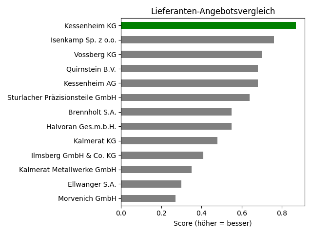
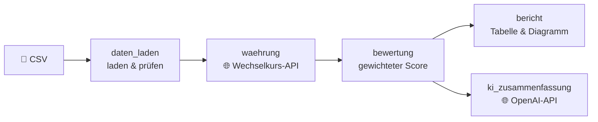

# 📦 Lieferanten-Angebotsvergleich

**Python-Tool, das Lieferantenangebote in verschiedenen Währungen vergleichbar macht, nach gewichteten Kriterien bewertet und per KI eine Kaufempfehlung ausspricht.**


---

## 💡 Das Problem

Im strategischen Einkauf kommen Angebote für denselben Artikel von Lieferanten aus ganz Europa – in **EUR, CZK, PLN oder CHF**, mit unterschiedlichen Lieferzeiten, Qualitätsstufen und Liefertreuen. Der billigste Anbieter ist selten der beste.

Dieses Tool beantwortet die Frage: **Welcher Lieferant ist unterm Strich das beste Angebot?**

## ✨ Features

- 📥 **Robuster CSV-Import** – repariert typische Formatfehler automatisch (`3,58` → `3.58`, `Kč` → `CZK`, deutsches Datumsformat …) und sortiert unbrauchbare Zeilen mit Begründung aus
- 💱 **Live-Wechselkurse** über die [Frankfurter API](https://frankfurter.dev) (offizielle EZB-Kurse) – mit Notfall-Kursen, falls die API nicht erreichbar ist
- ⚖️ **Gewichtete Mehrkriterien-Bewertung** – Preis, Lieferzeit, Qualität, Liefertreue und Reklamationsquote, frei konfigurierbar in `config.py`
- 📊 **Rangliste & Diagramm** pro Artikel
- 🤖 **KI-Kaufempfehlung** mit GPT-4o – inkl. Ersatz-Empfehlung, falls die KI nicht verfügbar ist

## 🖼️ Beispiel



```
WG-30-005 – Drehteil Welle Ø20x120 C45  (11 Angebote)

Platz  Lieferant                 land  Preis (€)  Lieferzeit (Tage)  Qualität (1-5)  Score
1      Morvenich GmbH & Co. KG   DE    8.88       4                  5               0.84
2      Quirnstein GmbH           CH    8.08       16                 4               0.69
3      Teckwald s.r.o.           CZ    8.40       19                 5               0.66
...
```

## ⚙️ So funktioniert's



**Bewertungslogik:** Jedes Kriterium wird pro Artikel per Min-Max-Normalisierung auf 0–1 skaliert (1 = bester Wert), mit seinem Gewicht multipliziert und aufsummiert. Verglichen wird immer nur innerhalb desselben Artikels.

| Kriterium | Gewicht | Besser ist |
|---|---|---|
| Einzelpreis (EUR) | 40 % | niedrig |
| Lieferzeit | 20 % | niedrig |
| Qualität (1–5) | 20 % | hoch |
| Liefertreue | 10 % | hoch |
| Reklamationsquote | 10 % | niedrig |

## 🚀 Installation & Start

```bash
git clone https://github.com/MaxXSammy/lieferanten-angebotsvergleich.git
cd lieferanten-angebotsvergleich
pip install -r requirements.txt
```

Für die KI-Empfehlung eine `.env` anlegen:
```
OPENAI_API_KEY=sk-...
```
*(Ohne Key läuft das Programm trotzdem – dann mit einer Empfehlung ohne KI.)*

Starten:
```bash
python main.py                                  # Standard-Testdaten
python main.py daten/angebote_fehlerhaft.csv    # Fehlerbehandlung live sehen
```

## 📁 Projektstruktur

```
├── main.py                  # Ablaufsteuerung & Menü
├── config.py                # Kriterien, Gewichte, API-Einstellungen
├── daten_laden.py           # CSV laden, reparieren, validieren
├── waehrung.py              # Wechselkurs-API → Umrechnung in EUR
├── bewertung.py             # Normalisierung, Scoring, Rangliste
├── bericht.py               # Tabelle & Balkendiagramm
├── ki_zusammenfassung.py    # KI-Empfehlung (OpenAI)
└── daten/
    ├── angebote.csv             # 170 Angebote, 36 Lieferanten, 12 Artikel
    └── angebote_fehlerhaft.csv  # dieselben Daten mit ~50 Praxisfehlern
```

## 🛡️ Fehlerbehandlung

| Situation | Reaktion |
|---|---|
| Formatfehler in der CSV (Komma, €, Leerzeichen, Datum) | wird automatisch repariert |
| Unbrauchbare Werte (fehlender Preis, Qualität 9, Duplikate …) | Zeile wird mit Begründung aussortiert |
| Wechselkurs-API nicht erreichbar | Notfall-Kurse aus `config.py` |
| KI nicht verfügbar / kein API-Key | regelbasierte Ersatz-Empfehlung |

## 🔭 Geplante Erweiterungen

- 🗺️ **Entfernungs-API** (OpenStreetMap) – Transportweg zum Werk als zusätzliches Kriterium für Kosten & CO₂
- 📤 Export der Rangliste als Excel
- 🖥️ Web-Oberfläche mit Streamlit

## 👥 Team

Entstanden am Projekttag *Funktionen & Module* (16.10.2026) im Rahmen der Weiterbildung zum AI Engineer.

| | Module |
|---|---|
| **Maximilian Schneider** · [@MaxXSammy](https://github.com/MaxXSammy) | `config.py`, `waehrung.py`, `bewertung.py`, `daten_laden.py`, `main.py` |
| **Jonas** | `bericht.py`, `ki_zusammenfassung.py`, `main.py` |

---

<sub>ℹ️ Alle Lieferanten, Artikel und Preise in den Beispieldaten sind frei erfunden.</sub>
