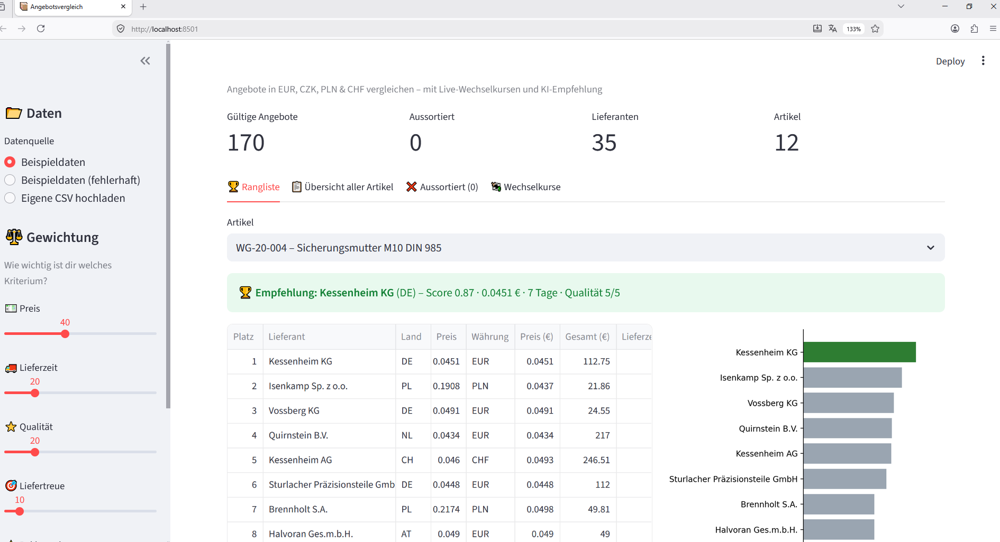
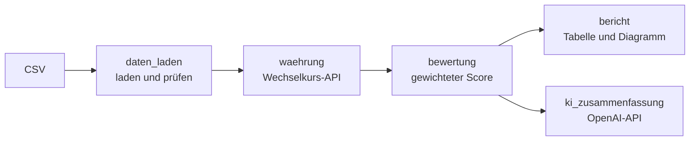

# Lieferanten-Angebotsvergleich

[](https://github.com/MaxXSammy/lieferanten-angebotsvergleich/actions/workflows/ci.yml)

Ein Python-Tool, das Lieferantenangebote in verschiedenen Währungen vergleichbar macht, nach gewichteten Kriterien bewertet und per KI eine Kaufempfehlung ausspricht.

## Das Problem

Im strategischen Einkauf kommen Angebote für denselben Artikel von Lieferanten aus ganz Europa, in EUR, CZK, PLN oder CHF, mit unterschiedlichen Lieferzeiten, Qualitätsstufen und Liefertreuen. Der billigste Anbieter ist selten der beste.

Dieses Tool beantwortet die Frage: **Welcher Lieferant ist unterm Strich das beste Angebot?**

## Die Lösung

- **Robuster CSV-Import:** repariert typische Formatfehler automatisch (`3,58` → `3.58`, `Kč` → `CZK`, deutsches Datumsformat) und sortiert unbrauchbare Zeilen mit Begründung aus
- **Live-Wechselkurse** über die [Frankfurter API](https://frankfurter.dev) (offizielle EZB-Kurse), mit Notfall-Kursen, falls die API nicht erreichbar ist
- **Gewichtete Mehrkriterien-Bewertung:** Preis, Lieferzeit, Qualität, Liefertreue und Reklamationsquote, frei konfigurierbar in `config.py`
- **Rangliste und Diagramm** pro Artikel
- **KI-Kaufempfehlung** mit GPT-4o, mit regelbasierter Ersatz-Empfehlung, falls die KI nicht verfügbar ist
- **Web-Oberfläche** mit Streamlit: CSV hochladen, Gewichte per Schieberegler anpassen, Ergebnis sofort sehen




```
WG-30-005 – Drehteil Welle Ø20x120 C45  (11 Angebote)

Platz  Lieferant                 land  Preis (€)  Lieferzeit (Tage)  Qualität (1-5)  Score
1      Morvenich GmbH & Co. KG   DE    8.88       4                  5               0.84
2      Quirnstein GmbH           CH    8.08       16                 4               0.69
3      Teckwald s.r.o.           CZ    8.40       19                 5               0.66
...
```

## Architektur



**Bewertungslogik:** Jedes Kriterium wird pro Artikel per Min-Max-Normalisierung auf 0–1 skaliert (1 = bester Wert), mit seinem Gewicht multipliziert und aufsummiert. Verglichen wird immer nur innerhalb desselben Artikels.

| Kriterium | Gewicht | Besser ist |
|---|---|---|
| Einzelpreis (EUR) | 40 % | niedrig |
| Lieferzeit | 20 % | niedrig |
| Qualität (1–5) | 20 % | hoch |
| Liefertreue | 10 % | hoch |
| Reklamationsquote | 10 % | niedrig |

## Fehlerbehandlung

| Situation | Reaktion |
|---|---|
| Formatfehler in der CSV (Komma, €, Leerzeichen, Datum) | wird automatisch repariert |
| Unbrauchbare Werte (fehlender Preis, Qualität 9, Duplikate) | Zeile wird mit Begründung aussortiert |
| Wechselkurs-API nicht erreichbar | Notfall-Kurse aus `config.py` |
| KI nicht verfügbar oder kein API-Key | regelbasierte Ersatz-Empfehlung |

## Tech-Stack

| Bereich | Technologie |
|---|---|
| Sprache | Python 3.9+ |
| Daten | pandas |
| KI | OpenAI API (GPT-4o) |
| Wechselkurse | Frankfurter API (EZB) |
| Oberfläche | Streamlit |
| Qualität | pytest, GitHub Actions |

## Installation

```bash
git clone https://github.com/MaxXSammy/lieferanten-angebotsvergleich.git
cd lieferanten-angebotsvergleich
pip install -r requirements.txt
```

Für die KI-Empfehlung eine `.env` mit `OPENAI_API_KEY=sk-...` anlegen. Ohne Key läuft das Programm trotzdem, dann mit der regelbasierten Empfehlung.

## Nutzung

```bash
streamlit run app.py                            # Web-Oberfläche
python main.py                                  # Terminal mit Standard-Testdaten
python main.py daten/angebote_fehlerhaft.csv    # Fehlerbehandlung mit fehlerhaften Daten
```

## Tests

```bash
pip install pytest
pytest -q
```

Die Tests laufen ohne Netzwerk und ohne API-Key, auch in der CI.

## Projektstruktur

```
app.py                   # Web-Oberfläche (Streamlit)
main.py                  # Terminal-Version mit Menü
config.py                # Kriterien, Gewichte, API-Einstellungen
daten_laden.py           # CSV laden, reparieren, validieren
waehrung.py              # Wechselkurs-API, Umrechnung in EUR
bewertung.py             # Normalisierung, Scoring, Rangliste
bericht.py               # Tabelle und Balkendiagramm
ki_zusammenfassung.py    # KI-Empfehlung (OpenAI)
tests/                   # pytest: Scoring, CSV-Reparatur, Wechselkurse
daten/
├── angebote.csv             # 170 Angebote, 36 Lieferanten, 12 Artikel
└── angebote_fehlerhaft.csv  # dieselben Daten mit ~50 Praxisfehlern
```

## Bekannte Grenzen

- Die Min-Max-Normalisierung bewertet relativ: Kommt ein Angebot hinzu oder fällt eines weg, ändern sich die Scores aller anderen. Ein einzelner Ausreißer staucht die übrigen Werte zusammen, und bei nur einem Angebot erhält es automatisch den Score 1,0.
- Verglichen wird der Einzelpreis. Mindestbestellmenge, Zahlungsziel, Zertifizierungen und Mengenstaffeln fließen nicht in den Score ein, ebenso wenig Logistik- und Wechselkosten.
- Einheiten werden vereinheitlicht (`Stück` → `Stk`), aber nicht umgerechnet. Angebote für denselben Artikel in unterschiedlichen Einheiten (Stück und Meter) wären nicht vergleichbar. In den Testdaten kommt das nicht vor.
- Abgelaufene Angebote werden nicht aussortiert. Geprüft wird nur, dass `gueltig_bis` nicht vor dem Angebotsdatum liegt.
- Umgerechnet wird mit dem aktuellen EZB-Kurs, nicht mit dem Kurs zum Angebotsdatum. Die Notfall-Kurse in `config.py` sind fest hinterlegt und veralten, außerdem werden nur EUR, CZK, PLN und CHF unterstützt.
- Die Qualitätsnote (1–5) ist eine Eingabe aus der CSV und damit so gut wie die Lieferantenbewertung, aus der sie stammt.
- Die KI-Empfehlung wird nicht automatisch gegen die Rangliste geprüft. Der Prompt verbietet erfundene Zahlen, eine Kontrolle im Code gibt es aber nicht. Außerdem gehen die Top-5-Angebote dafür an die OpenAI-API, also an einen Cloud-Dienst.
- Die Tests decken Bewertung, CSV-Import und Wechselkurse ab, nicht die KI-Empfehlung, die Berichte und die Oberfläche.

## Roadmap

- [ ] Entfernungs-API (OpenStreetMap): Transportweg zum Werk als zusätzliches Kriterium für Kosten und CO₂
- [ ] Export der Rangliste als Excel
- [ ] Online-Demo über Streamlit Community Cloud

## Team

Entstanden am Projekttag *Funktionen & Module* (16.10.2026) im Rahmen der Weiterbildung zum AI Engineer.

| | Module |
|---|---|
| **Maximilian Schneider** · [@MaxXSammy](https://github.com/MaxXSammy) | `config.py`, `waehrung.py`, `bewertung.py`, `daten_laden.py`, `main.py`, `app.py` |
| **Florian** · [@fthiele92](https://github.com/fthiele92) | `bericht.py`, `ki_zusammenfassung.py`, `main.py` |

Alle Lieferanten, Artikel und Preise in den Beispieldaten sind frei erfunden.

## Lizenz

MIT, siehe [LICENSE](LICENSE).
